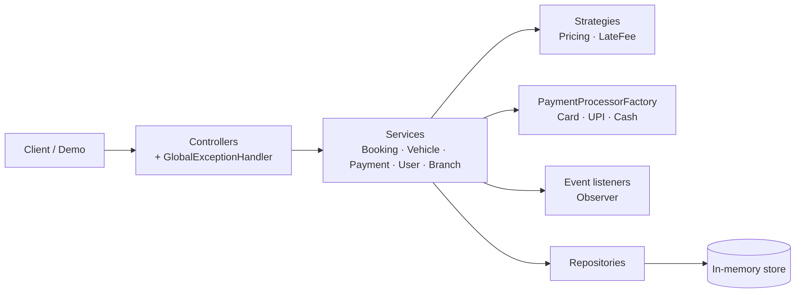
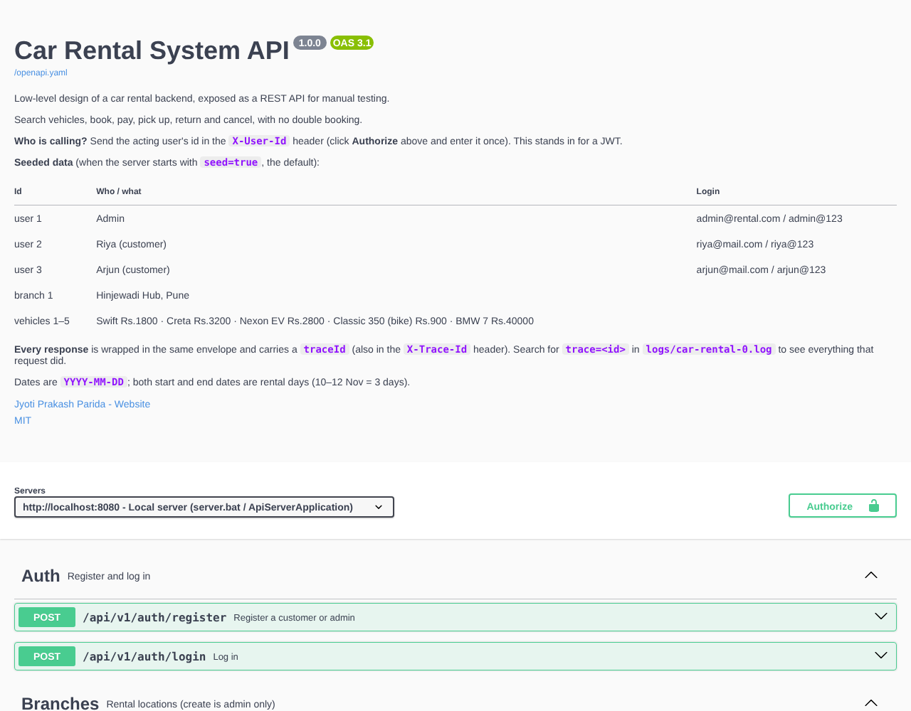

# 🚗 Car Rental System: Low-Level Design in Java

A small but complete **car rental backend** built to learn how a real system is **structured and designed before it is coded**: requirements, entities, relationships, layers, interfaces vs. abstract classes, enums, design patterns, and the hard part (no double booking under concurrency).

Plain **Java 17**, **zero dependencies**, **42 passing tests**, a **REST API with OpenAPI 3.1 + Swagger UI** you can test from Postman or Requestly, structured **logging with request tracing and an audit trail**, and an end-to-end demo that walks through every requirement.

> Author: **Jyoti Prakash Parida**

---

## ✨ What it does

| Customers | Admins | System |
|---|---|---|
| Register and log in | Create branches | Prices bookings (pluggable strategy) |
| Search available cars and bikes by branch, dates, type, seats | Add cars and bikes | Prevents double booking, even with 30+ simultaneous requests |
| Book, pay (Card / UPI / Cash), cancel with refund | Mark vehicles under maintenance | Charges late fees on late return |
| View booking history and payments | Hand over (pickup) and receive (return) vehicles | Expires unpaid bookings after 15 minutes; notifies on every booking event |
| | | Logs every request with a trace id and writes an audit trail of every business action |

## 🏗️ Architecture at a glance



<sub>Diagram source: [architecture-overview.mmd](docs/diagrams/architecture-overview.mmd)</sub>

Layered architecture: **Controller → Service → Repository**, with every dependency injected through constructors from one composition root (`CarRentalSystem`).

## 🧩 Design patterns used

| Pattern | Where |
|---|---|
| Strategy | `PricingStrategy`, `LateFeePolicy`, `PaymentProcessor` |
| Factory | `PaymentProcessorFactory` |
| Template Method | `AbstractPaymentProcessor` |
| State (enum-based) | `BookingStatus.canTransitionTo` + `Booking` transition methods |
| Observer | `BookingEventListener` |
| Singleton | `CarRentalSystem.getInstance()` (double-checked locking) |
| Repository, DTO, Dependency Injection | `repository`, `dto`, all services |

## 📚 Documentation

| # | Document | What's inside |
|---|---|---|
| 1 | [Requirements](docs/01-requirements.md) | Actors, 15 functional requirements, business rules, 10 non-functional requirements, scope |
| 2 | [Architecture](docs/02-architecture.md) | Layers, package structure, dependency graph, cross-cutting concerns, Spring Boot mapping, deployment view |
| 3 | [Class Design](docs/03-class-design.md) | Interface vs. abstract vs. concrete vs. enum vs. singleton: every class classified, class diagrams |
| 4 | [Design Patterns & SOLID](docs/04-design-patterns.md) | Each pattern with code and the problem it solves |
| 5 | [Data Model](docs/05-data-model.md) | ER diagram, relationships, inheritance mapping, SQL schema, the overlap query |
| 6 | [Flows & State Machine](docs/06-flows-and-state-machine.md) | Booking lifecycle, sequence diagrams, concurrency and locking options |
| 7 | [API Design](docs/07-api-design.md) | REST endpoints, sample requests, error codes |
| 8 | [Decisions & Roadmap](docs/08-design-decisions-and-roadmap.md) | Step-by-step design procedure, trade-offs, limitations, roadmap |
| 9 | [Logging, Tracing & Audit](docs/09-logging-and-audit.md) | Log levels, trace ids, audit trail format, what never to log, Spring equivalent |
| 10 | [**API Testing Guide**](docs/10-api-testing-guide.md) | Run the REST API; test with Swagger UI, Postman, Requestly, curl; 21-step manual checklist |

## 🌐 Test it as a REST API (Swagger UI · Postman · Requestly)

```bat
server.bat                      :: or run ApiServerApplication in IntelliJ
```

| Open | What |
|---|---|
| http://localhost:8080/swagger-ui | Interactive docs: **Authorize** with a user id (1 admin, 2 Riya, 3 Arjun) → **Try it out** |
| http://localhost:8080/openapi.yaml | OpenAPI 3.1 contract |
| `postman/CarRental.postman_collection.json` | Import into **Postman** or **Requestly**: 41 requests, 106 automatic checks, re-runnable |



Step-by-step instructions: **[docs/10-api-testing-guide.md](docs/10-api-testing-guide.md)**.

## 🚀 Getting started

**Requirements:** JDK 17 or newer. Maven is optional.

### Run the demo

```bash
# Windows
run.bat

# macOS / Linux
./run.sh

# with DEBUG logs on the console (or "trace" for everything)
run.bat debug

# or with Maven
mvn package
java -jar target/car-rental-system-1.0.0.jar
```

Logs are written to `logs/car-rental-0.log` (everything) and `logs/audit-0.log` (audit trail). See [docs/09](docs/09-logging-and-audit.md).

### Run the tests

```bash
# Windows
test.bat

# macOS / Linux
./test.sh
```

Expected: `CarRentalSystemTest: 29 passed`, `LoggingAndAuditTest: 7 passed`, `HttpApiTest: 6 passed` (0 failed). In IntelliJ, run `AllTests.main()`.

### Demo output (excerpt)

```
-- 5. Double booking is rejected ------------------------------------------------
  HTTP 201 Created -> Booking#2 vehicle#3 2026-11-10->2026-11-12 total Rs.8400.00 [PENDING_PAYMENT]
  HTTP 409 ERROR -> Vehicle 3 is already booked between 2026-11-11 and 2026-11-14

-- 6. Concurrency: 20 customers click 'Book' on the same Swift at the same instant
  Requests: 20 | succeeded: 1 | rejected with 409: 19
  [OK] Exactly one booking won. No double booking.

-- 8. UPI limit: Rs.1,20,000 booking is declined, booking stays unpaid, card works
  HTTP 402 ERROR -> Payment declined: UPI limit exceeded (max Rs.100000 per transaction)
  HTTP 201 Created -> Payment#5 Rs.120000.00 CARD RENTAL [SUCCESS] ref=CARD-20FE3763
```

## 📁 Project structure

```
car-rental-system-lld/
├── docs/                                  design documentation (10 files + diagrams/ + images/)
├── postman/                               Postman / Requestly collection + environment
├── src/main/java/com/jyoti/carrental/
│   ├── CarRentalApplication.java          console demo entry point
│   ├── ApiServerApplication.java          REST API entry point (http://localhost:8080)
│   ├── web/                               HTTP server, router, JSON, seed data
│   ├── config/CarRentalSystem.java        singleton composition root
│   ├── controller/                        REST-style controllers + exception handler
│   ├── dto/request, dto/response/         validated input / output records
│   ├── service/ + service/impl/           business contracts and logic
│   ├── strategy/pricing, strategy/latefee/
│   ├── payment/                           processors, template method, factory
│   ├── event/                             observer: events and listeners
│   ├── scheduler/                         unpaid-booking cleanup job
│   ├── repository/                        generic + concrete in-memory repositories
│   ├── model/ + model/enums/              entities and enums
│   ├── exception/                         typed business exceptions
│   ├── logging/                           trace ids, log format, audit trail, data masking
│   └── util/                              password hashing, validation, vehicle locks
├── src/main/resources/                    openapi.yaml + Swagger UI page
├── src/test/java/com/jyoti/carrental/     42 tests (behaviour, logging/audit, HTTP) + mini test runner
├── pom.xml
├── run.bat / test.bat / server.bat (+ .sh versions)
└── LICENSE
```

## 🧠 Key design ideas worth remembering

1. **`VehicleStatus` has no `BOOKED` value.** A car booked for 10–12 Nov is free on 13 Nov, so availability is computed from bookings, never stored as a flag.
2. **Booking is the central entity.** It connects who, what, where, when and money, like Order in e-commerce or Reservation in hotels.
3. **Two ranges overlap when `start1 <= end2 AND end1 >= start2`.** The same query solves hotel rooms, meeting rooms and appointments.
4. **Re-check availability at booking time, under a lock.** Search results go stale the moment they are shown.
5. **Money is `BigDecimal`, time is an injected `Clock`.**
6. **Every request has a trace id; every business action has an audit line, including failed and denied ones.**
7. **Program to interfaces, wire in one place.** Swapping pricing rules or payment gateways is a one-line change.

## 🛣️ Roadmap

Spring Boot port (JPA + PostgreSQL, Spring Security + JWT, JUnit 5), database-level double-booking guard, cancellation policy, hourly rentals, Kafka notifications, Docker and CI. Details in [docs/08](docs/08-design-decisions-and-roadmap.md#84-roadmap).

## 📄 License

[MIT](LICENSE) © 2026 Jyoti Prakash Parida
