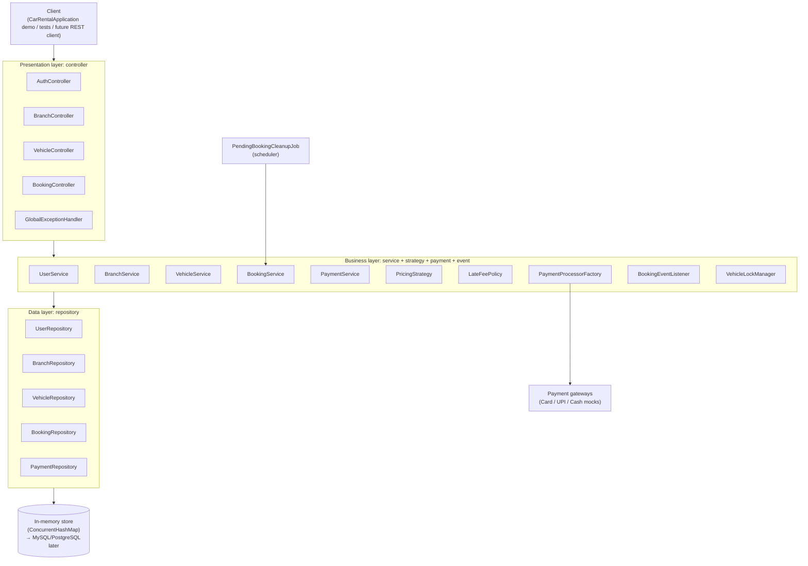
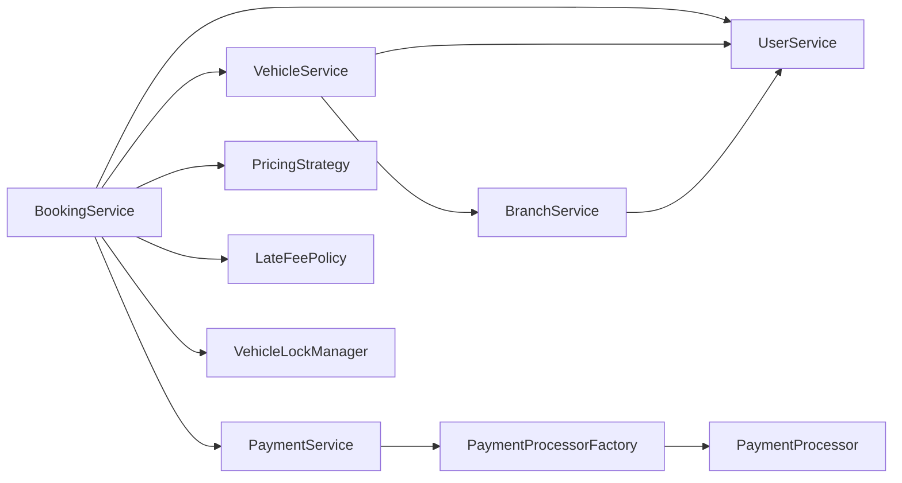
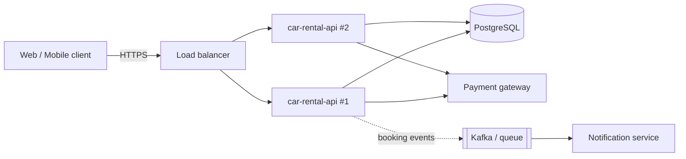

# 2. Architecture

## 2.1 Style: layered (n-tier) architecture

Each layer has one job and may only call the layer directly below it. Dependencies point **downwards only**.



| Layer | Package | Responsibility | Must NOT |
|---|---|---|---|
| Presentation | `controller`, `dto` | Accept input, call one service method, wrap the result in `ApiResponse`, map exceptions to status codes | Contain business rules or touch repositories |
| Business | `service`, `strategy`, `payment`, `event`, `util` | All rules: validation needing state, availability, pricing, state transitions, locking, orchestration | Know about HTTP or response formats |
| Data | `repository` | Store and query entities | Contain business decisions |
| Domain | `model`, `model.enums` | Entities with their own invariants (e.g. `Booking` enforces its state machine) | Depend on services |
| Wiring | `config` | Build every object once and connect them (composition root) | Contain logic |

## 2.2 Package structure

```
com.jyoti.carrental
├── CarRentalApplication.java        entry point: end-to-end demo
├── config/
│   └── CarRentalSystem              singleton composition root (the "Spring container")
├── controller/                      presentation layer
│   ├── AuthController, BranchController, VehicleController, BookingController
│   └── GlobalExceptionHandler       exception → status code (like @RestControllerAdvice)
├── dto/
│   ├── request/                     validated input records
│   └── response/                    output records + ApiResponse envelope
├── service/                         business contracts (interfaces)
│   └── impl/                        implementations + BookingRules
├── strategy/
│   ├── pricing/                     PricingStrategy, DailyPricingStrategy, WeekendPricingStrategy
│   └── latefee/                     LateFeePolicy, StandardLateFeePolicy
├── payment/                         PaymentProcessor, AbstractPaymentProcessor, Card/Upi/Cash, Factory
├── event/                           BookingEvent, BookingEventListener (Observer), ConsoleNotificationListener
├── scheduler/                       PendingBookingCleanupJob
├── repository/                      CrudRepository, InMemoryRepository, 5 concrete repositories
├── model/                           BaseEntity, User, Branch, Vehicle, Car, Bike, Booking, Payment
│   └── enums/                       9 enums
├── exception/                       CarRentalException + 8 subclasses
└── util/                            PasswordHasher, Validate, VehicleLockManager
```

## 2.3 Dependency graph between services



There are **no cycles**. `PaymentService` does not know booking states. `BookingService` orchestrates: it charges through `PaymentService` and then changes the booking itself. If `PaymentService` confirmed bookings while `BookingService` asked it for refunds, the two would depend on each other, which is a design smell (and in Spring, a startup error with constructor injection).

## 2.4 Cross-cutting concerns

| Concern | Approach |
|---|---|
| **Error handling** | Business errors extend `CarRentalException` and carry their HTTP status. `GlobalExceptionHandler` turns them into `ApiResponse.error`. Unknown errors become a generic 500 so internals never leak. |
| **Validation** | Shape checks (blank, null, positive, email) in request DTO constructors via `Validate`. Rules that need state or time (dates vs. today, overlap, ownership) in services. |
| **Concurrency** | Every booking mutation runs under that vehicle's lock. Repositories use concurrent collections. |
| **Time** | Every class that needs "now" receives a `java.time.Clock`. Tests move a `MutableClock` instead of sleeping. |
| **Security** | Salted password hashes, role checks in services (not controllers, so no endpoint can bypass them), identical login error messages. |
| **Notifications** | Observer: services publish `BookingEvent`s; listeners react. A failing listener is logged and never breaks the booking. |

## 2.5 How this maps to Spring Boot

The plain-Java design is a one-to-one blueprint for a Spring Boot service:

| This project | Spring Boot |
|---|---|
| `CarRentalSystem` builds and wires objects | Spring IoC container, `@Configuration` / component scan |
| Objects created once in `CarRentalSystem` | Beans with default **singleton** scope |
| `XxxController` methods with `// POST /api/v1/...` | `@RestController` + `@PostMapping` |
| `GlobalExceptionHandler.handle` | `@RestControllerAdvice` + `@ExceptionHandler` |
| `Validate` in record constructors | `@Valid` + `@NotBlank`, `@Email`, `@Positive` |
| `CrudRepository` / `InMemoryRepository` | `JpaRepository<T, Long>` |
| `BookingRepository.existsActiveOverlap` | `@Query` JPQL with the same overlap condition |
| `VehicleLockManager.withLock` | `@Transactional` + `@Lock(PESSIMISTIC_WRITE)` on the vehicle row |
| `BaseEntity` | `@MappedSuperclass` with `@Id`, `@CreatedDate` |
| `Vehicle` → `Car`, `Bike` | `@Inheritance(strategy = SINGLE_TABLE)` |
| `BookingEventListener` | `ApplicationEventPublisher` + `@EventListener` (or Kafka) |
| `PendingBookingCleanupJob` | `@Scheduled(fixedRate = 60_000)` |
| `PasswordHasher` | `BCryptPasswordEncoder` |
| `Clock` injection | a `@Bean Clock` |

## 2.6 Deployment view (target, after the Spring port)



With more than one instance, the in-JVM lock is no longer enough. Locking must move to the database (`SELECT ... FOR UPDATE` or an exclusion constraint on `(vehicle_id, daterange)` in PostgreSQL). See [08-design-decisions-and-roadmap.md](08-design-decisions-and-roadmap.md).
