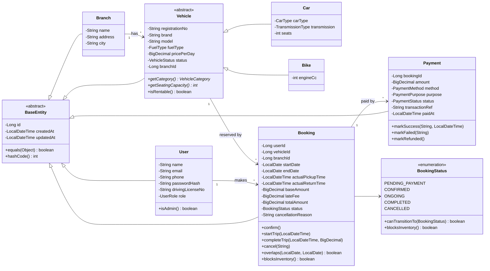
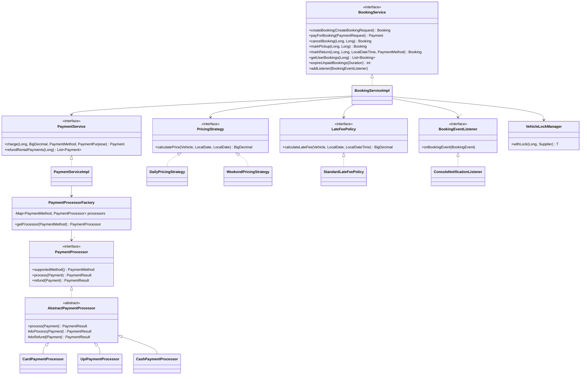

# 3. Class Design

## 3.1 How to decide: interface, abstract class, concrete class, enum or singleton

| Use | When | Ask yourself |
|---|---|---|
| **Interface** | Several classes do the **same job in different ways** | "Will there be more than one way to do this?" |
| **Abstract class** | Several classes share **data or code**, but each also differs, and the parent alone is meaningless | "Do these share fields or logic, and should the parent never be created on its own?" |
| **Concrete class** | A real thing you actually create and use | "Do I create objects of this?" |
| **Enum** | A **small, fixed** set of values known at compile time | "Is this list fixed in code, not added by users at runtime?" |
| **Singleton** | Exactly **one shared instance** for the whole app | "Would two copies cause bugs or waste?" |
| **Record** | Immutable data carrier (DTOs, results, events) | "Is this just data with no identity or behaviour?" |

Short version: **interface = "can do"**, **abstract class = "is a" + shared code**.

## 3.2 Classification of every type in the project

### Interfaces (contracts)

| Interface | Why it is an interface | Implementations |
|---|---|---|
| `CrudRepository<T>` | Storage can change (memory → JPA) without touching services | `InMemoryRepository<T>` and its subclasses |
| `UserService`, `BranchService`, `VehicleService`, `BookingService`, `PaymentService` | Callers depend on the contract, not the implementation (Dependency Inversion); easy to mock | `*ServiceImpl` |
| `PricingStrategy` | Many pricing rules, one job | `DailyPricingStrategy`, `WeekendPricingStrategy` |
| `LateFeePolicy` | Penalty rules change independently of pricing | `StandardLateFeePolicy` |
| `PaymentProcessor` | Card, UPI, Cash each pay differently | via `AbstractPaymentProcessor` → `Card/Upi/CashPaymentProcessor` |
| `BookingEventListener` | Any number of unknown reactions to booking events | `ConsoleNotificationListener` (later: Email, SMS, Kafka) |

### Abstract classes (shared state + code, never instantiated)

| Abstract class | Shared data / code | Subclasses |
|---|---|---|
| `BaseEntity` | `id`, `createdAt`, `updatedAt`, `equals/hashCode` by id | every entity |
| `Vehicle` | registration, brand, model, fuel, price, status, branch; `isRentable()`; abstract `getCategory()`, `getSeatingCapacity()` | `Car`, `Bike` |
| `InMemoryRepository<T>` | id sequence, timestamps, storage, `findWhere` | 5 repositories |
| `AbstractPaymentProcessor` | Template Method: validate → `doProcess` → log | `Card/Upi/CashPaymentProcessor` |
| `CarRentalException` | message + HTTP status | 8 specific exceptions |

### Concrete classes

| Group | Classes |
|---|---|
| Entities | `User`, `Branch`, `Car`, `Bike`, `Booking`, `Payment` |
| Repositories | `UserRepository`, `BranchRepository`, `VehicleRepository`, `BookingRepository`, `PaymentRepository` |
| Services | `UserServiceImpl`, `BranchServiceImpl`, `VehicleServiceImpl`, `BookingServiceImpl`, `PaymentServiceImpl` |
| Strategies | `DailyPricingStrategy`, `WeekendPricingStrategy`, `StandardLateFeePolicy` |
| Payments | `CardPaymentProcessor`, `UpiPaymentProcessor`, `CashPaymentProcessor`, `PaymentProcessorFactory` |
| Controllers | `AuthController`, `BranchController`, `VehicleController`, `BookingController`, `GlobalExceptionHandler` |
| Infrastructure | `VehicleLockManager`, `PendingBookingCleanupJob`, `ConsoleNotificationListener` |
| Utilities (final, private constructor) | `PasswordHasher`, `Validate`, `BookingRules` |
| Exceptions | `InvalidRequestException` (400), `AuthenticationException` (401), `PaymentFailedException` (402), `AccessDeniedException` (403), `ResourceNotFoundException` (404), `VehicleNotAvailableException`, `DuplicateResourceException`, `InvalidBookingStateException` (409) |

### Enums

| Enum | Values | Behaviour inside |
|---|---|---|
| `UserRole` | CUSTOMER, ADMIN | |
| `VehicleCategory` | CAR, BIKE | |
| `CarType` | HATCHBACK, SEDAN, SUV, LUXURY | |
| `FuelType` | PETROL, DIESEL, ELECTRIC, CNG | |
| `TransmissionType` | MANUAL, AUTOMATIC | |
| `VehicleStatus` | AVAILABLE, UNDER_MAINTENANCE, INACTIVE | **No BOOKED value**: availability depends on dates, so it is computed from bookings |
| `BookingStatus` | PENDING_PAYMENT, CONFIRMED, ONGOING, COMPLETED, CANCELLED | `canTransitionTo()`, `blocksInventory()` (State pattern) |
| `PaymentStatus` | PENDING, SUCCESS, FAILED, REFUNDED | |
| `PaymentMethod` | CARD, UPI, CASH | key for the Factory |
| `PaymentPurpose` | RENTAL, LATE_FEE | |
| `BookingEventType` | CREATED, CONFIRMED, PICKED_UP, RETURNED, CANCELLED, EXPIRED | |

**Not enums:** branches, cities and brands are data that admins add at runtime, so they are entities/fields, not enums.

### Records (immutable data)

`RegisterUserRequest`, `LoginRequest`, `CreateBranchRequest`, `AddCarRequest`, `AddBikeRequest`, `VehicleSearchRequest`, `CreateBookingRequest`, `PaymentRequest`, `ApiResponse<T>`, `UserResponse`, `BranchResponse`, `VehicleResponse`, `BookingResponse`, `PaymentResponse`, `PaymentResult`, `BookingEvent`.

### Singleton

| Where | How |
|---|---|
| `CarRentalSystem.getInstance()` | Hand-written: private constructor + `volatile` field + double-checked locking |
| Every repository, service, strategy, factory, controller | Created exactly once inside `CarRentalSystem` and shared. This is a singleton **by container**, exactly like Spring beans. |

**Never** make entities singletons: there are many users, vehicles and bookings.

## 3.3 Class diagram: domain model

## 3.4 Class diagram: services, strategies and payments

## 3.5 Members at a glance (services)

| Service | Methods |
|---|---|
| `UserService` | `register(RegisterUserRequest)`, `login(LoginRequest)`, `getUser(Long)`, `requireAdmin(Long)` |
| `BranchService` | `createBranch(adminId, CreateBranchRequest)`, `getBranch(Long)`, `getAllBranches()` |
| `VehicleService` | `addCar(adminId, AddCarRequest)`, `addBike(adminId, AddBikeRequest)`, `changeStatus(adminId, vehicleId, VehicleStatus)`, `getVehicle(Long)`, `getVehiclesByBranch(Long)`, `searchAvailable(VehicleSearchRequest)` |
| `BookingService` | `createBooking`, `payForBooking`, `cancelBooking`, `markPickup`, `markReturn`, `getBooking`, `getUserBookings`, `getPayments`, `expireUnpaidBookings`, `addListener` |
| `PaymentService` | `charge(bookingId, amount, method, purpose)`, `refundRentalPayments(bookingId)`, `getPaymentsForBooking(bookingId)` |
