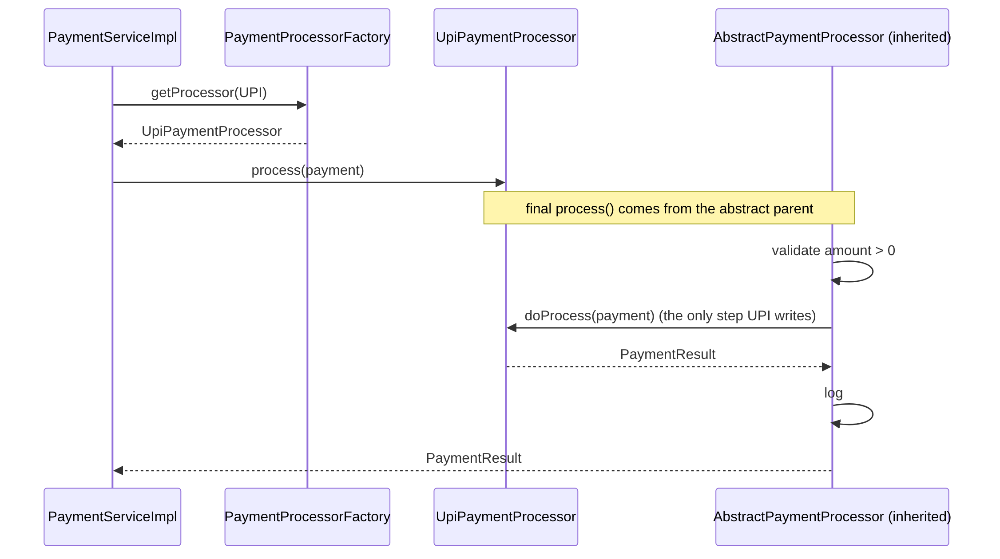

# 4. Design Patterns and SOLID

## 4.1 Patterns used

| Pattern | Type | Where | Problem it solves |
|---|---|---|---|
| **Strategy** | Behavioural | `PricingStrategy`, `LateFeePolicy`, `PaymentProcessor` | Swap algorithms without if-else chains |
| **Factory** | Creational | `PaymentProcessorFactory` | Choose the right processor from a `PaymentMethod` |
| **Template Method** | Behavioural | `AbstractPaymentProcessor` | Fixed steps (validate → process → log) with one varying step |
| **State** (enum-based) | Behavioural | `BookingStatus.canTransitionTo`, `Booking.transitionTo` | Only legal status changes are possible |
| **Observer** | Behavioural | `BookingEventListener`, `BookingServiceImpl.publish` | Notify others without coupling booking code to them |
| **Singleton** | Creational | `CarRentalSystem.getInstance()` + shared instances | One composition root and one instance of each service |
| **Repository** | Architectural | `CrudRepository`, `*Repository` | Hide storage behind a collection-like interface |
| **DTO** | Architectural | `dto.request`, `dto.response` | Decouple API shape from entities; never expose password hashes |
| **Dependency Injection** (constructor) | Architectural | every service | Testable, explicit dependencies |
| **Composition Root** | Architectural | `CarRentalSystem` | All wiring in one place |

## 4.2 Strategy

```java
public interface PricingStrategy {
    BigDecimal calculatePrice(Vehicle vehicle, LocalDate start, LocalDate end);
}
// BookingServiceImpl only knows the interface:
BigDecimal price = pricingStrategy.calculatePrice(vehicle, start, end);
```

To switch the whole system to weekend pricing, change one line in `CarRentalSystem`:

```java
PricingStrategy pricingStrategy = new WeekendPricingStrategy(new BigDecimal("1.25"));
```

Without the pattern, `BookingServiceImpl` would grow `if (weekend) ... else if (festival) ... else if (coupon)`, and every new rule would mean editing (and re-testing) the most critical class.

## 4.3 Factory + Strategy + Template Method together



<sub>Diagram source: [payment-sequence.mmd](diagrams/payment-sequence.mmd)</sub>

Adding **Net Banking** = one class `NetBankingPaymentProcessor extends AbstractPaymentProcessor`, one enum value, and one entry in the list passed to the factory. Nothing else changes.

## 4.4 State (via enum)

```java
public boolean canTransitionTo(BookingStatus next) {
    return switch (this) {
        case PENDING_PAYMENT -> next == CONFIRMED || next == CANCELLED;
        case CONFIRMED       -> next == ONGOING   || next == CANCELLED;
        case ONGOING         -> next == COMPLETED;
        case COMPLETED, CANCELLED -> false;
    };
}
```

`Booking` has **no public `setStatus`**. All changes go through `confirm()`, `startTrip()`, `completeTrip()`, `cancel()`, which call a private `transitionTo()` that checks the rule. This is a *rich domain model*: the entity protects its own invariants.

A full GoF State pattern (one class per state) is worth it when each state has a lot of different behaviour. Here an enum is the simpler, correct choice.

## 4.5 Observer

```java
bookingService.addListener(new ConsoleNotificationListener(true));
bookingService.addListener(event -> auditLog.write(event));   // a lambda works too
```

`BookingServiceImpl.publish()` catches listener exceptions, so a broken email sender can never roll back a booking.

## 4.6 Singleton

```java
private static volatile CarRentalSystem instance;

public static CarRentalSystem getInstance() {
    if (instance == null) {                         // fast path, no lock
        synchronized (CarRentalSystem.class) {
            if (instance == null) {                 // check again inside the lock
                instance = new CarRentalSystem(Clock.systemDefaultZone(), true);
            }
        }
    }
    return instance;
}
```

- **Why `volatile`?** Without it, another thread could see a non-null reference to an object whose constructor hasn't finished.
- **Why only one hand-written singleton?** Services and repositories are created once in the composition root and shared, which makes them singletons in practice, like Spring beans. Hand-coding `getInstance()` into every class would hide dependencies and make tests share state.
- **Tests** call `CarRentalSystem.create(clock, false)` for a fresh, isolated system.

## 4.7 SOLID checklist

| Principle | Example in this project |
|---|---|
| **S**ingle Responsibility | `PricingStrategy` prices, `LateFeePolicy` penalises, `PaymentService` moves money, `BookingService` orchestrates, controllers only translate |
| **O**pen/Closed | New pricing rule, payment method, vehicle type or listener = new class, no edits to existing ones |
| **L**iskov Substitution | Any `Vehicle` (Car, Bike) works everywhere a `Vehicle` is expected; any `PaymentProcessor` works in the factory |
| **I**nterface Segregation | Small, focused interfaces: `LateFeePolicy` is separate from `PricingStrategy`; `BookingEventListener` has one method |
| **D**ependency Inversion | Controllers depend on `BookingService` (interface), services on `CrudRepository`-style repositories and strategy interfaces, all injected through constructors |
