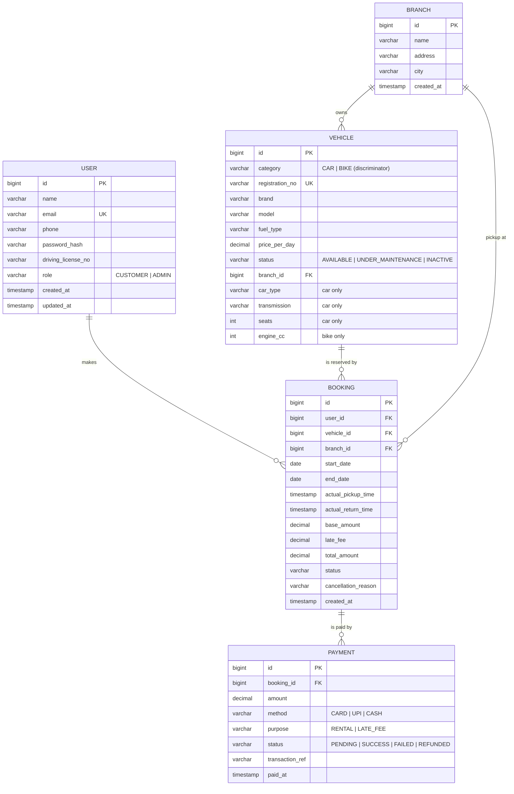

# 5. Data Model

## 5.1 Entity-relationship diagram



## 5.2 Relationships and how to reason about them

| Relationship | Cardinality | Ask | Foreign key on |
|---|---|---|---|
| Branch → Vehicle | 1 : N | Can a branch have many vehicles? Yes. Can a vehicle be in many branches at once? No. | `vehicle.branch_id` |
| User → Booking | 1 : N | One user, many bookings over time. | `booking.user_id` |
| Vehicle → Booking | 1 : N | One vehicle, many bookings on different dates. | `booking.vehicle_id` |
| Booking → Payment | 1 : N | Rental payment, plus maybe a late-fee payment, plus failed attempts. | `payment.booking_id` |

**Rule:** the foreign key always lives on the "many" side.

**Booking is the central entity.** It links who (user), what (vehicle), where (branch), when (dates) and money (payments). Many-to-many between User and Vehicle is resolved *through* Booking, which also carries its own data (dates, price, status).

In the Java code, entities hold foreign-key **ids** (`Long vehicleId`) rather than object references. That mirrors the tables, keeps the in-memory model simple, and avoids accidental deep object graphs. In JPA these become `@ManyToOne(fetch = LAZY)` references.

## 5.3 Inheritance mapping

`Vehicle` is abstract with `Car` and `Bike` subclasses. In SQL use **single-table inheritance**: one `vehicle` table with a `category` discriminator column and nullable subclass columns. It is the simplest and fastest option for search queries ("all vehicles at branch X"). Alternatives: *joined* (one table per subclass, more joins) or *table-per-class* (no shared table, painful polymorphic queries).

## 5.4 Reference SQL schema (PostgreSQL)

```sql
CREATE TABLE app_user (
    id                 BIGSERIAL PRIMARY KEY,
    name               VARCHAR(100) NOT NULL,
    email              VARCHAR(150) NOT NULL UNIQUE,
    phone              VARCHAR(20)  NOT NULL,
    password_hash      VARCHAR(255) NOT NULL,
    driving_license_no VARCHAR(30),
    role               VARCHAR(20)  NOT NULL,
    created_at         TIMESTAMP    NOT NULL DEFAULT now(),
    updated_at         TIMESTAMP    NOT NULL DEFAULT now()
);

CREATE TABLE branch (
    id         BIGSERIAL PRIMARY KEY,
    name       VARCHAR(100) NOT NULL,
    address    VARCHAR(255) NOT NULL,
    city       VARCHAR(60)  NOT NULL,
    created_at TIMESTAMP    NOT NULL DEFAULT now()
);

CREATE TABLE vehicle (
    id              BIGSERIAL PRIMARY KEY,
    category        VARCHAR(10)   NOT NULL,          -- discriminator
    registration_no VARCHAR(20)   NOT NULL UNIQUE,
    brand           VARCHAR(50)   NOT NULL,
    model           VARCHAR(50)   NOT NULL,
    fuel_type       VARCHAR(20)   NOT NULL,
    price_per_day   NUMERIC(10,2) NOT NULL CHECK (price_per_day > 0),
    status          VARCHAR(20)   NOT NULL,
    branch_id       BIGINT        NOT NULL REFERENCES branch(id),
    car_type        VARCHAR(20),
    transmission    VARCHAR(20),
    seats           INT,
    engine_cc       INT,
    version         BIGINT        NOT NULL DEFAULT 0  -- optimistic locking, optional
);
CREATE INDEX idx_vehicle_branch ON vehicle(branch_id, status);

CREATE TABLE booking (
    id                  BIGSERIAL PRIMARY KEY,
    user_id             BIGINT        NOT NULL REFERENCES app_user(id),
    vehicle_id          BIGINT        NOT NULL REFERENCES vehicle(id),
    branch_id           BIGINT        NOT NULL REFERENCES branch(id),
    start_date          DATE          NOT NULL,
    end_date            DATE          NOT NULL CHECK (end_date >= start_date),
    actual_pickup_time  TIMESTAMP,
    actual_return_time  TIMESTAMP,
    base_amount         NUMERIC(12,2) NOT NULL,
    late_fee            NUMERIC(12,2) NOT NULL DEFAULT 0,
    total_amount        NUMERIC(12,2) NOT NULL,
    status              VARCHAR(20)   NOT NULL,
    cancellation_reason VARCHAR(255),
    created_at          TIMESTAMP     NOT NULL DEFAULT now(),
    updated_at          TIMESTAMP     NOT NULL DEFAULT now()
);
-- Speeds up the overlap query
CREATE INDEX idx_booking_vehicle_dates ON booking(vehicle_id, start_date, end_date);
CREATE INDEX idx_booking_user ON booking(user_id);

-- Database-level guarantee against double booking (PostgreSQL, needs btree_gist):
-- CREATE EXTENSION IF NOT EXISTS btree_gist;
-- ALTER TABLE booking ADD CONSTRAINT no_overlap EXCLUDE USING gist (
--     vehicle_id WITH =,
--     daterange(start_date, end_date, '[]') WITH &&
-- ) WHERE (status IN ('PENDING_PAYMENT','CONFIRMED','ONGOING'));

CREATE TABLE payment (
    id              BIGSERIAL PRIMARY KEY,
    booking_id      BIGINT        NOT NULL REFERENCES booking(id),
    amount          NUMERIC(12,2) NOT NULL CHECK (amount > 0),
    method          VARCHAR(10)   NOT NULL,
    purpose         VARCHAR(10)   NOT NULL,
    status          VARCHAR(10)   NOT NULL,
    transaction_ref VARCHAR(64),
    failure_reason  VARCHAR(255),
    paid_at         TIMESTAMP,
    created_at      TIMESTAMP     NOT NULL DEFAULT now()
);
CREATE INDEX idx_payment_booking ON payment(booking_id);
```

## 5.5 The overlap query

Two date ranges `[s1, e1]` and `[s2, e2]` overlap when **`s1 <= e2 AND e1 >= s2`**.

```sql
SELECT EXISTS (
  SELECT 1 FROM booking
   WHERE vehicle_id = :vehicleId
     AND status IN ('PENDING_PAYMENT','CONFIRMED','ONGOING')
     AND start_date <= :newEnd
     AND end_date   >= :newStart
);
```

The same condition solves hotel rooms, meeting rooms and doctor appointments.
