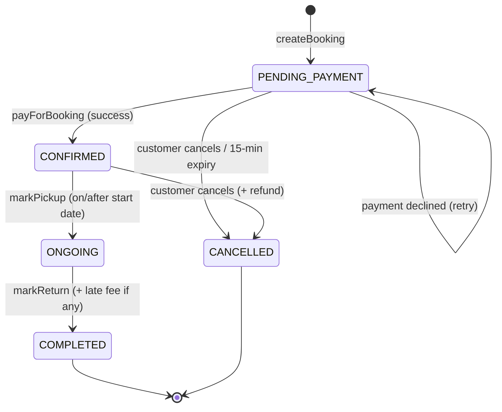
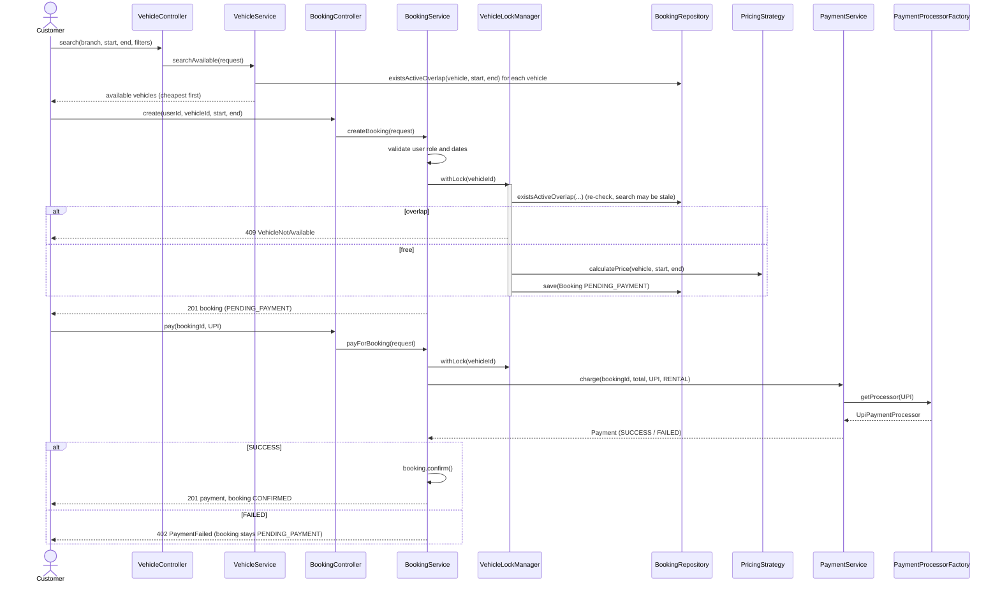
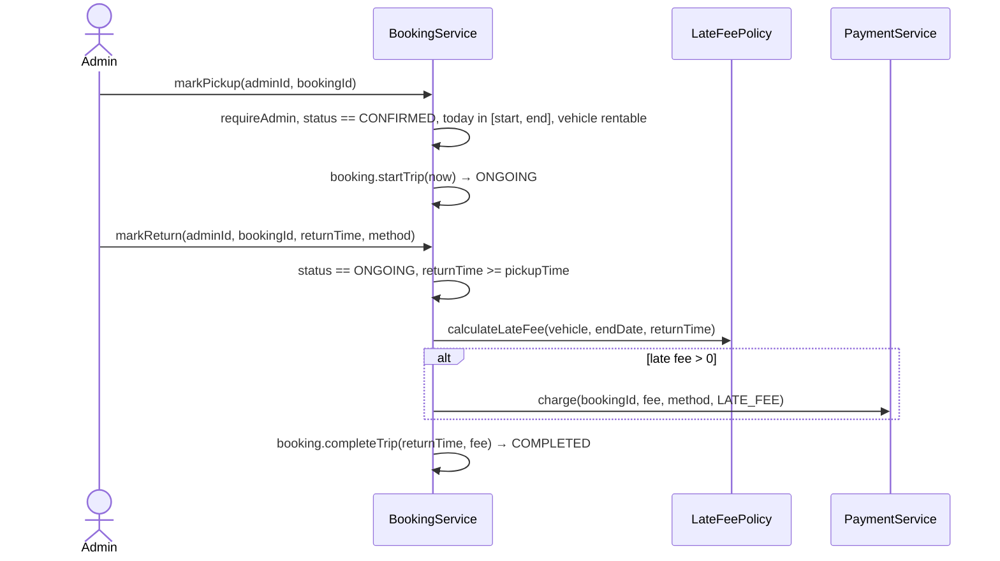
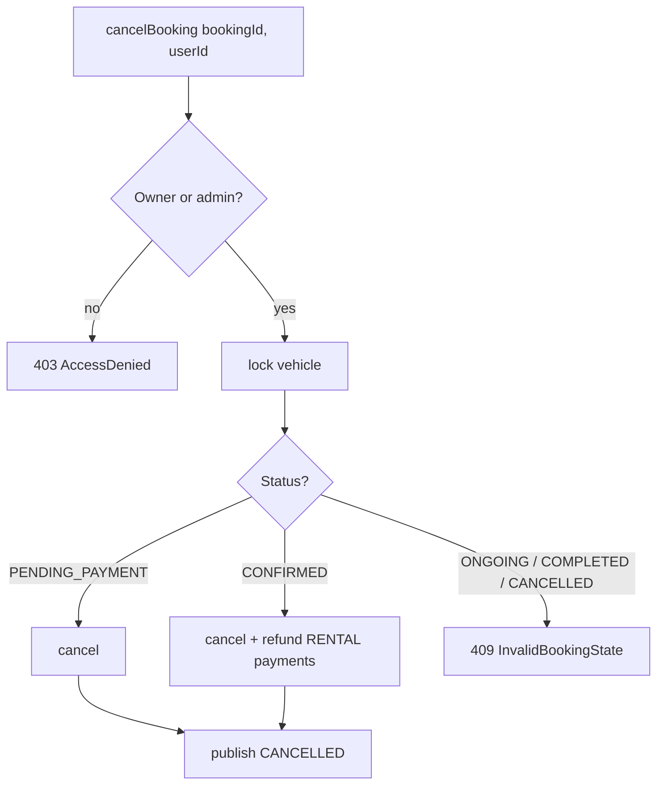
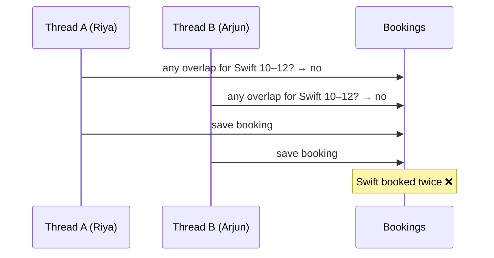

# 6. Flows and State Machine

## 6.1 Booking state machine

| From \ To | PENDING_PAYMENT | CONFIRMED | ONGOING | COMPLETED | CANCELLED |
|---|---|---|---|---|---|
| PENDING_PAYMENT | – | ✅ | ❌ | ❌ | ✅ |
| CONFIRMED | ❌ | – | ✅ | ❌ | ✅ |
| ONGOING | ❌ | ❌ | – | ✅ | ❌ |
| COMPLETED | ❌ | ❌ | ❌ | – | ❌ |
| CANCELLED | ❌ | ❌ | ❌ | ❌ | – |

Blocking statuses (vehicle is held for the dates): **PENDING_PAYMENT, CONFIRMED, ONGOING**.

## 6.2 Search → book → pay

## 6.3 Pickup and return

**Late fee example:** Creta at ₹3,200/day, booked 5–7 Nov, returned 9 Nov 11:00 → 2 late days × 3,200 × 1.5 = **₹9,600**; total = 9,600 + 9,600 = ₹19,200.

## 6.4 Cancel and refund

## 6.5 Unpaid booking expiry

Every minute (`PendingBookingCleanupJob`), bookings that are still `PENDING_PAYMENT` 15 minutes after creation are cancelled. The status is **re-checked under the vehicle lock**, because the customer may have paid a millisecond earlier.

## 6.6 Concurrency: preventing double booking

**The race without a lock:**

**With `VehicleLockManager`:** the check and the save for one vehicle run as one atomic step. Thread B waits for A, then sees A's booking and gets 409. Bookings for *different* vehicles still run in parallel because each vehicle has its own lock.

Proven by `testConcurrentBookingsForSameVehicleOnlyOneWins` (32 threads, exactly 1 success, 31 conflicts) and section 6 of the demo.

**Options in a database-backed version:**

| Approach | How | Trade-off |
|---|---|---|
| Pessimistic lock | `SELECT ... FROM vehicle WHERE id = ? FOR UPDATE` inside `@Transactional`, then check overlap and insert | Simple, correct, serialises bookings per vehicle |
| Optimistic lock | `@Version` on vehicle, bump it on every booking; retry on `OptimisticLockException` | No waiting, but retries under contention |
| DB constraint | PostgreSQL exclusion constraint on `(vehicle_id, daterange)` | Strongest guarantee; DB-specific |
| Distributed lock | Redis lock keyed by vehicle id | Needed only if logic spans services |

A JVM lock (this project) only works for a **single instance**. Once you run two app servers, move to one of the database options.
