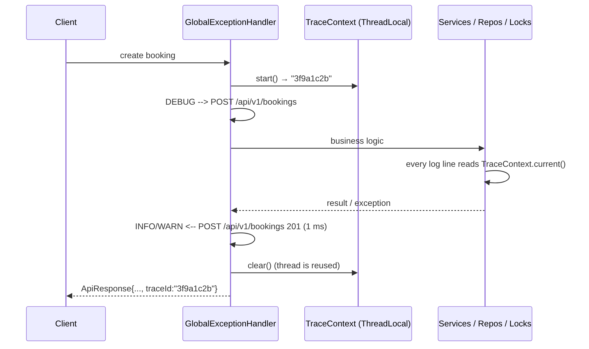

# 9. Logging, Tracing and Audit

> Logs answer **"what did the system do and why?"** The audit trail answers **"who did what, to which record, and did it work?"** This project keeps both, and ties every line of one request together with a trace id.

## 9.1 What gets written where

| Output | Contents | Default level | Who reads it |
|---|---|---|---|
| `logs/car-rental-0.log` | Everything: request start/end, business steps, decisions, errors **and** audit lines | INFO | Developers, support |
| `logs/audit-0.log` | Only audit events (one line per business action) | always INFO | Support, finance, security |
| Console | Whatever passes the console level | ERROR (keeps the demo readable) | You, while running |

Files roll over at 5 MB and keep 5 generations: `-0` is always the newest, older files move to `-1 … -4`. The `logs/` folder is in `.gitignore`.

## 9.2 Run with different levels

```bat
run.bat            :: files INFO, console ERROR
run.bat debug      :: files + console DEBUG (decisions: overlap check, price, late fee, state changes)
run.bat trace      :: everything, including lock acquire/release and repository INSERT/UPDATE
```

Or set it yourself: `-Dlog.level=DEBUG -Dlog.console=INFO -Dlog.dir=logs`, or the environment variables `LOG_LEVEL`, `LOG_CONSOLE`, `LOG_DIR`.

## 9.3 Log line format

```
2026-11-05 16:04:48.512 | INFO  | main            | trace=3f9a1c2b     | BookingServiceImpl         | Booking#2 created: User#3 Vehicle#3 2026-11-10..2026-11-12 Rs.8400.00 [PENDING_PAYMENT]
└──── timestamp ──────┘   level   thread             trace id              class                        message
```

Levels use the SLF4J names everyone knows:

| Level | Used for | Examples in this project |
|---|---|---|
| **ERROR** | Something broke and needs a human | Unexpected exception (500) with stack trace; refund failed; cleanup job crashed |
| **WARN** | Expected business failure | 4xx responses (overlap, bad dates, access denied); payment declined |
| **INFO** | A business step completed | Booking created / confirmed / cancelled / completed; vehicle added; request finished with status and duration |
| **AUDIT** | Who did what (separate logger) | `action=PAYMENT outcome=SUCCESS actor=user:2 target=Booking#1 ...` |
| **DEBUG** | Why a decision was made | Overlap check → free/CONFLICT; price via which strategy; late fee calculation; state `PENDING_PAYMENT -> CONFIRMED`; lock contention |
| **TRACE** | Fine-grained internals | Lock acquire/release; repository INSERT/UPDATE; why each vehicle was skipped in search; event publishing |

## 9.4 Request tracing (trace id)



<sub>Diagram source: [request-tracing.mmd](diagrams/request-tracing.mmd)</sub>

- `GlobalExceptionHandler.handle()` starts a trace for every request and **always** clears it in `finally`, because pooled threads are reused.
- The trace id is returned in every `ApiResponse`. When something fails, the user reports the trace id, and support runs one search:

  ```bat
  findstr "trace=3f9a1c2b" logs\car-rental-0.log
  ```
- Background work gets its own trace: the cleanup job uses `job-xxxxxxxx`.
- Concurrent requests never mix ids, because `TraceContext` is a `ThreadLocal`.

**Example: one booking request at TRACE level**

```
DEBUG | GlobalExceptionHandler | --> POST /api/v1/bookings
DEBUG | BookingServiceImpl     | createBooking user=3 vehicle=3 dates=2026-11-10..2026-11-12
TRACE | VehicleLockManager     | Acquiring lock Vehicle#3
TRACE | VehicleLockManager     | Lock Vehicle#3 acquired
DEBUG | BookingServiceImpl     | Overlap check Vehicle#3 2026-11-10..2026-11-12 -> free
DEBUG | BookingServiceImpl     | Price via DAILY_FLAT: Rs.8400.00
TRACE | InMemoryRepository     | INSERT Booking#2
TRACE | VehicleLockManager     | Lock Vehicle#3 released
INFO  | BookingServiceImpl     | Booking#2 created: User#3 Vehicle#3 2026-11-10..2026-11-12 Rs.8400.00 [PENDING_PAYMENT]
AUDIT | audit                  | action=BOOKING_CREATED outcome=SUCCESS actor=user:3 target=Booking#2 details="vehicle=3 ..."
DEBUG | ConsoleNotificationListener | Notification CREATED sent to User#3
INFO  | GlobalExceptionHandler | <-- POST /api/v1/bookings 201 (1 ms)
```
(all lines carry the same `trace=…`)

## 9.5 Audit trail

Format (key=value, easy to grep now and to parse in ELK / Loki / Splunk later):

```
action=<AuditAction> outcome=<SUCCESS|FAILURE|DENIED> actor=<user:N|system> target=<Entity#id> details="<short text>"
```

| Action | Written when | Outcomes |
|---|---|---|
| `USER_REGISTERED` | Sign-up | SUCCESS, FAILURE (duplicate email) |
| `LOGIN` | Login attempt | SUCCESS, FAILURE (unknown email / wrong password; the real reason is only in the audit) |
| `ACCESS_DENIED` | Non-admin calls an admin action | DENIED |
| `BRANCH_CREATED`, `VEHICLE_ADDED`, `VEHICLE_STATUS_CHANGED` | Inventory changes (status shows `old -> new`) | SUCCESS, FAILURE |
| `BOOKING_CREATED` | Booking saved | SUCCESS, DENIED (admin tried to book) |
| `BOOKING_REJECTED` | Overlap or vehicle out of service | FAILURE |
| `PAYMENT` | Rental payment | SUCCESS (with gateway ref), FAILURE (declined, wrong state), DENIED (not owner) |
| `BOOKING_CANCELLED`, `REFUND_ISSUED` | Cancel and each refund | SUCCESS, FAILURE, DENIED |
| `VEHICLE_PICKED_UP`, `VEHICLE_RETURNED`, `LATE_FEE_CHARGED` | Handover, return, penalty | SUCCESS, FAILURE |
| `BOOKING_EXPIRED` | Cleanup job released an unpaid booking | SUCCESS (`actor=system`) |

**Failed and denied attempts are audited too.** A trail that only records successes cannot answer "who tried to cancel someone else's booking?".

## 9.6 Rules: what never goes into a log

| Never log | Instead |
|---|---|
| Passwords, password hashes | Nothing; "wrong password" is enough |
| Full emails | `LogSanitizer.maskEmail` → `r***@mail.com` |
| Licence / card / account numbers | `LogSanitizer.maskTail` → `***********1234` |
| Stack traces in API responses | Return the trace id; the stack trace stays in the log |

`LoggingAndAuditTest.testNoPasswordsHashesOrFullEmailsInLogs` scans every captured line to enforce this.

## 9.7 Design choices

| Choice | Why |
|---|---|
| `java.util.logging` (JUL) | Built into the JDK, keeping the project at zero dependencies. The patterns are the same in SLF4J + Logback. |
| One logger per class (`Logger.getLogger(X.class.getName())`) | Class name appears in every line; levels can be tuned per package. |
| Lambda messages: `LOG.fine(() -> "..." + x)` | The string is only built if the level is enabled, so DEBUG lines cost nothing in production. |
| Business 4xx at WARN without stack trace, 5xx at ERROR with stack trace | Expected failures shouldn't look like crashes; real bugs need the full trace. |
| `AuditLogger` injected through constructors | Same DI style as every other dependency, and easy to replace with a DB- or Kafka-backed audit store. |
| Separate audit logger that ignores the app level | Turning debug noise down must never switch off the audit trail. |

## 9.8 Spring Boot equivalent

| Here | Spring Boot |
|---|---|
| `Logger.getLogger(...)` | `private static final Logger log = LoggerFactory.getLogger(X.class);` or Lombok `@Slf4j` |
| `LoggingConfig` | `logback-spring.xml` / `application.yml` → `logging.level.com.jyoti=DEBUG` |
| `TraceContext` | `MDC.put("traceId", …)` in a `OncePerRequestFilter`, or Micrometer Tracing (automatic `traceId`/`spanId`) |
| `LogFormatter` | Logback pattern `%d | %-5level | %thread | trace=%X{traceId} | %logger{0} | %msg%n` |
| `AuditLogger` | Dedicated audit logger/appender, Spring Data Envers, or audit events published to Kafka |
| Rolling `FileHandler` | Logback `RollingFileAppender` with `SizeAndTimeBasedRollingPolicy` |
