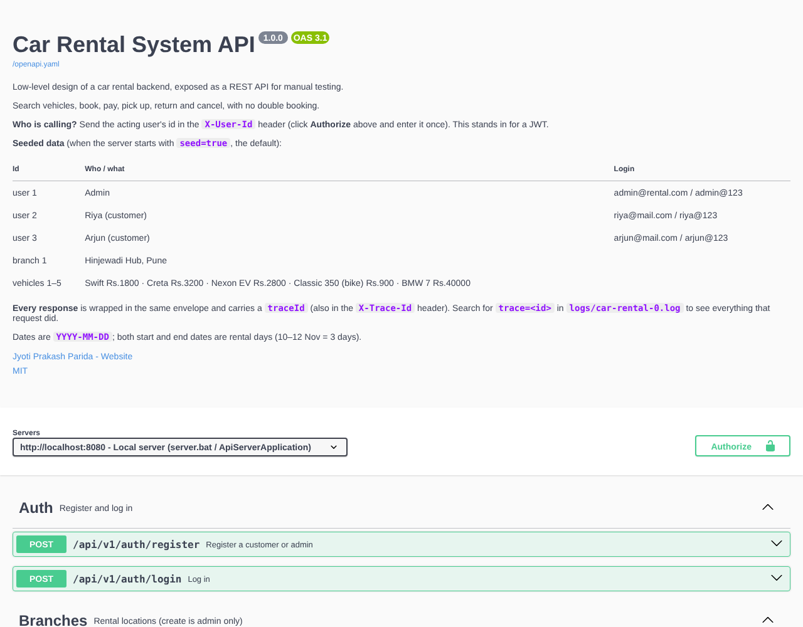
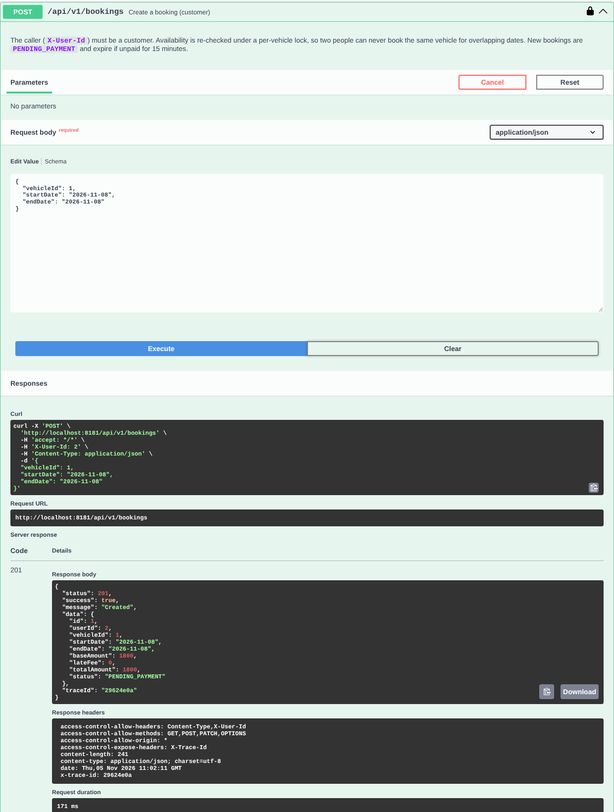

# 10. API Testing Guide: Swagger UI, Postman, Requestly and curl

This guide shows how to run the Car Rental System as a **REST API** and test it by hand, step by step, with any tool you like.

| Tool | Best for | Setup time |
|---|---|---|
| **Swagger UI** (built in) | Reading the API and clicking "Try it out" in the browser | none |
| **Postman** | Running the ready-made collection of 41 requests with 106 automatic checks | import 1 file |
| **Requestly** | Same collection in a lighter, open-source client | import 1 file |
| **curl** | Quick checks from the terminal, scripting | none |

> **Why OpenAPI 3.1 + Swagger UI?** OpenAPI is the industry standard for describing REST APIs, and **3.1** is the version every tool reads today (Swagger UI, Postman, Requestly, Redocly, code generators). OpenAPI 3.2 exists, but tooling is still catching up, so 3.1 is the safe choice. "Swagger" is now the name of the tools (Swagger UI / Editor), not the spec. In Spring Boot you would generate the same contract automatically with **springdoc-openapi**.

---

## 1. Start the API server

The server is plain Java (the JDK's built-in HTTP server); no Tomcat, no Spring, no downloads.

### Option A: IntelliJ IDEA
1. Open `src/main/java/com/jyoti/carrental/ApiServerApplication.java`.
2. Click the green **▶** next to `main` → **Run 'ApiServerApplication.main()'**.
3. The Run window shows:

```
==============================================================================
  Car Rental API is running
==============================================================================
  Swagger UI   : http://localhost:8080/swagger-ui
  OpenAPI spec : http://localhost:8080/openapi.yaml
  Health       : http://localhost:8080/health
  Postman      : import postman/CarRental.postman_collection.json

  Seeded data (send the user id in the X-User-Id header):
    Admin  id=1  admin@rental.com / admin@123
    Riya   id=2  riya@mail.com    / riya@123   (customer)
    Arjun  id=3  arjun@mail.com   / arjun@123  (customer)
    Branch id=1  Hinjewadi Hub, Pune
    Vehicles: 1 Swift Rs.1800 | 2 Creta Rs.3200 | 3 Nexon EV Rs.2800 | 4 Classic 350 Rs.900 | 5 BMW 7 Rs.40000
```

4. Stop it with the red **■** button. Data is in memory, so every restart starts clean.

**Other port:** Run → Edit Configurations → VM options → `-Dserver.port=9090`.

### Option B: Command Prompt
```bat
cd /d D:\04_Projects\Practice_book\car-rental-system-lld
server.bat            :: port 8080
server.bat 9090       :: another port
```
Stop with **Ctrl+C**.

### Quick check
Open **http://localhost:8080/health** in a browser → `{"status":"UP"}`.

If port 8080 is busy (`Address already in use`), use another port, or find the process with `netstat -ano | findstr :8080`.

---

## 2. Two things every request needs to know

### 2.1 Who is calling: the `X-User-Id` header
There is no login token yet, so the caller identifies themselves with a header:

| X-User-Id | Who | Can do |
|---|---|---|
| `1` | Admin | create branches, add vehicles, change status, pickup, return, cancel any booking |
| `2` | Riya (customer) | search, book, pay, cancel **her own** bookings |
| `3` | Arjun (customer) | same, for his bookings |

- Missing header on a protected endpoint → **401**.
- Wrong role (e.g. Riya adds a car) → **403**.
- Public endpoints (login, register, search, get booking, branch list, history) don't need it.

> In a production system this header would be replaced by a **JWT**: the user logs in, gets a signed token, and sends `Authorization: Bearer <token>`. The server reads the user id from the verified token instead of trusting a header. That is in the roadmap (Spring Security).

### 2.2 Every response has the same shape, plus a trace id

```json
{
  "status": 409,
  "success": false,
  "message": "Vehicle 3 is already booked between 2026-11-11 and 2026-11-14",
  "data": null,
  "traceId": "7d8a0a17"
}
```

The trace id is also in the **`X-Trace-Id`** response header. To see exactly what the server did for that request:

```bat
findstr "trace=7d8a0a17" logs\car-rental-0.log
```

---

## 3. Swagger UI (browser, zero setup)

1. Start the server and open **http://localhost:8080/swagger-ui** (or just http://localhost:8080).
2. Click **Authorize** (top right), type a user id (e.g. `2` for Riya), click **Authorize**, then **Close**. It is remembered across page reloads.
3. Open any endpoint, edit the example body, and click **Execute**. Swagger UI shows the curl command, the response body, headers (including `x-trace-id`) and the duration.





**Tips**
- To act as the admin, click **Authorize** → **Logout** → enter `1`.
- Dates must not be in the past: change the example dates to today or later.
- Swagger UI's scripts load from a CDN (cdn.jsdelivr.net), so the browser needs internet. Without internet, use Postman/Requestly or open the raw spec at `/openapi.yaml`.

---

## 4. Postman

### 4.1 Import
1. Open Postman → **Import** (top left) → drag in both files from the project's `postman/` folder:
   - `CarRental.postman_collection.json`
   - `CarRental-Local.postman_environment.json`
2. Top-right environment dropdown → choose **Car Rental - Local**.

(You can also import `http://localhost:8080/openapi.yaml` via **Import → Link** to auto-generate requests from the spec, but the ready-made collection is better: it has the right order, saved ids and automatic checks.)

### 4.2 What's in the collection

| Folder | What it checks | Requests |
|---|---|---|
| 00 Setup | Server is up; logs in admin, Riya, Arjun; reads branch and vehicle ids; **computes dates from today** | 6 |
| 01 Happy path | Search SUVs → book Creta → pay UPI → CONFIRMED → pickup → return 2 days late (late fee Rs.9,600, total Rs.19,200) → 2 payments | 7 |
| 02 No double booking | Arjun books Nexon; Riya's overlapping booking → **409**; search hides it | 3 |
| 03 Cancel and refund | Pay; another user can't cancel (**403**); owner cancels; payment **REFUNDED**; pickup of cancelled → **409** | 5 |
| 04 Payment declined | Rs.1,20,000 via UPI → **402**; still PENDING_PAYMENT; card works; cleanup | 5 |
| 05 Validation, auth and errors | No header **401**, wrong password **401**, customer adds car **403**, past date **400**, bad enum **400**, no licence **400**, unknown id **404**, cancel completed **409** | 8 |
| 06 Admin | Create branch, add car, duplicate plate **409**, maintenance hides it from search, register customer | 6 |
| 07 History | Riya sees only her own bookings | 1 |

Each request has **Tests** (see the request's *Scripts → Post-response* tab) that check status, values and the trace id, and save ids (`bookingId`, `arjunBookingId`, …) for the next requests.

### 4.3 Run it
- **One by one (manual check):** click each request in order → **Send** → look at the body and the **Test Results** tab.
- **Everything at once:** right-click the collection → **Run collection** → **Run Car Rental System API**.

Expected: **41 requests, 106 tests, 0 failed**. The collection uses dates relative to today and random plate numbers/emails, so you can **run it again without restarting the server**.

### 4.4 From the command line (newman, optional)
```bash
npx newman run postman/CarRental.postman_collection.json -e postman/CarRental-Local.postman_environment.json
```

---

## 5. Requestly

Requestly's API client imports Postman v2/v2.1 collections and environments, and translates `pm.*` scripts to `rq.*` automatically ([Requestly docs](https://docs.requestly.com/api-client/import-export/import-from-postman)).

1. Open Requestly (desktop app or web) → **API Client**.
2. Sidebar header → **Import** → **Postman** → upload both files from `postman/` → **Import**.
3. Select the **Car Rental - Local** environment.
4. Send requests in folder order, or run the collection.

**OpenAPI import:** you can import `src/main/resources/openapi.yaml` (or the URL `http://localhost:8080/openapi.yaml`) as an OpenAPI file to get every endpoint with example bodies.

**Using the Requestly web app?** The browser calls `localhost` from a web page, which needs CORS. The server already sends `Access-Control-Allow-Origin: *` and allows the `X-User-Id` header, so it works. (Allowing any origin is fine for local testing only.)

---

## 6. curl (Windows Command Prompt)

Use the real Windows `curl` (built into Windows 10+). In PowerShell type `curl.exe`, because plain `curl` is a PowerShell alias for something else.

```bat
:: health
curl http://localhost:8080/health

:: search SUVs (change the dates to today and later)
curl "http://localhost:8080/api/v1/vehicles/search?branchId=1&startDate=2026-11-10&endDate=2026-11-12&carType=SUV"

:: Riya books the Creta (see the X-Trace-Id header with -i)
curl -i -X POST http://localhost:8080/api/v1/bookings -H "Content-Type: application/json" -H "X-User-Id: 2" -d "{\"vehicleId\":2,\"startDate\":\"2026-11-10\",\"endDate\":\"2026-11-12\"}"

:: pay booking 1 with UPI
curl -X POST http://localhost:8080/api/v1/bookings/1/payments -H "Content-Type: application/json" -H "X-User-Id: 2" -d "{\"method\":\"UPI\"}"

:: Arjun tries the same dates -> 409
curl -X POST http://localhost:8080/api/v1/bookings -H "Content-Type: application/json" -H "X-User-Id: 3" -d "{\"vehicleId\":2,\"startDate\":\"2026-11-11\",\"endDate\":\"2026-11-11\"}"
```

---

## 7. Manual test checklist

Tick these off in any tool. Start a fresh server first so the ids match.

| # | Action | Request | Expect |
|---|---|---|---|
| 1 | Server up | `GET /health` | 200 `{"status":"UP"}` |
| 2 | Login works | `POST /api/v1/auth/login` riya@mail.com / riya@123 | 200, `data.id = 2` |
| 3 | Wrong password | same with a wrong password | 401, "Invalid email or password" |
| 4 | Search | `GET /api/v1/vehicles/search?branchId=1&startDate=<today>&endDate=<today+2>` | 200, 5 vehicles, cheapest first |
| 5 | Book | `POST /api/v1/bookings` X-User-Id 2, Creta (2), today → today+2 | 201, PENDING_PAYMENT, 9600.00 |
| 6 | Double booking | same vehicle, overlapping dates, X-User-Id 3 | **409** |
| 7 | Pay | `POST /api/v1/bookings/1/payments` X-User-Id 2, `{"method":"UPI"}` | 201, SUCCESS, booking CONFIRMED |
| 8 | Pay twice | repeat 7 | 409, "payment not expected" |
| 9 | Pickup by customer | `POST /api/v1/bookings/1/pickup` X-User-Id 2 | 403 |
| 10 | Pickup by admin | same with X-User-Id 1 | 200, ONGOING |
| 11 | Late return | `POST /api/v1/bookings/1/return` X-User-Id 1, `returnTime` = today+4 T11:00:00 | 200, lateFee 9600, total 19200 |
| 12 | Payments | `GET /api/v1/bookings/1/payments` | RENTAL + LATE_FEE |
| 13 | UPI limit | book BMW (5) for 3 days, pay with UPI | 402, booking still PENDING_PAYMENT |
| 14 | Cancel + refund | pay a booking, then `POST .../cancel` as owner | 200 CANCELLED; payment REFUNDED |
| 15 | Cancel someone else's | `.../cancel` with the other customer's id | 403 |
| 16 | Maintenance | `PATCH /api/v1/vehicles/2/status` X-User-Id 1 `{"status":"UNDER_MAINTENANCE"}`, then search | Creta disappears |
| 17 | Bad input | `{"method":"BITCOIN"}`, past date, broken JSON | 400 with a clear message |
| 18 | Unknown | `GET /api/v1/bookings/999`, `GET /api/v1/nope` | 404 |
| 19 | Wrong method | `DELETE /api/v1/branches` | 405 with an `Allow` header |
| 20 | Trace | copy any `traceId`, search it in `logs/car-rental-0.log` | all lines of that request |
| 21 | Audit | open `logs/audit-0.log` | one line per action, including the failed/denied ones |

---

## 8. Endpoint reference

| Method | Path | X-User-Id | Body | Success |
|---|---|---|---|---|
| POST | `/api/v1/auth/register` | – | name, email, phone, password, drivingLicenseNo, role | 201 |
| POST | `/api/v1/auth/login` | – | email, password | 200 |
| GET | `/api/v1/branches` | – | – | 200 |
| POST | `/api/v1/branches` | admin | name, address, city | 201 |
| GET | `/api/v1/branches/{id}/vehicles` | – | – | 200 |
| POST | `/api/v1/vehicles/cars` | admin | registrationNo, brand, model, fuelType, pricePerDay, branchId, carType, transmission, seats | 201 |
| POST | `/api/v1/vehicles/bikes` | admin | registrationNo, brand, model, fuelType, pricePerDay, branchId, engineCc | 201 |
| PATCH | `/api/v1/vehicles/{id}/status` | admin | status | 200 |
| GET | `/api/v1/vehicles/search` | – | query: branchId, startDate, endDate, category?, carType?, minSeats? | 200 |
| POST | `/api/v1/bookings` | customer | vehicleId, startDate, endDate | 201 |
| GET | `/api/v1/bookings/{id}` | – | – | 200 |
| POST | `/api/v1/bookings/{id}/payments` | owner | method | 201 |
| GET | `/api/v1/bookings/{id}/payments` | – | – | 200 |
| POST | `/api/v1/bookings/{id}/cancel` | owner / admin | – | 200 |
| POST | `/api/v1/bookings/{id}/pickup` | admin | – | 200 |
| POST | `/api/v1/bookings/{id}/return` | admin | returnTime, lateFeeMethod? | 200 |
| GET | `/api/v1/users/{userId}/bookings` | – | – | 200 |

Full contract with schemas and examples: `src/main/resources/openapi.yaml` (served at `/openapi.yaml`).

---

## 9. How the HTTP layer fits the design

```
Postman / Swagger UI / curl
        │  HTTP + JSON
        ▼
HttpApiServer  ── Router (METHOD + /path/{id}) ── ApiRequest (JSON → DTO, X-User-Id)
        │
        ▼
Controllers ── GlobalExceptionHandler (trace id, status codes)   ← unchanged
        ▼
Services → Repositories                                           ← unchanged
```

The HTTP server is just **another adapter** in front of the same controllers the console demo uses. No service or business rule changed to add it. That is what the layered design buys you.

| This project | Spring Boot |
|---|---|
| `HttpApiServer` + `Router` | Embedded Tomcat + `@RestController` / `@GetMapping` |
| `ApiRequest` getters | `@PathVariable`, `@RequestParam`, `@RequestHeader`, `@RequestBody` |
| `Json` | Jackson (automatic) |
| Hand-written `openapi.yaml` | **springdoc-openapi** generates it from annotations; Swagger UI at `/swagger-ui.html` |
| `X-User-Id` header | Spring Security + JWT (`Authorization: Bearer …`) |
| `DemoDataSeeder` | `CommandLineRunner` or `data.sql` |
| `HttpApiTest` (JDK HttpClient) | `@SpringBootTest(webEnvironment = RANDOM_PORT)` + `TestRestTemplate` / `MockMvc` |

---

## 10. Troubleshooting

| Problem | Fix |
|---|---|
| `Address already in use` | Another app uses 8080: `server.bat 9090`, or stop the other process |
| Swagger UI page is blank | No internet for the CDN; use Postman/Requestly, or check firewall/proxy |
| `Missing resource /openapi.yaml` | You compiled with plain `javac`; use `server.bat` (copies resources) or run from IntelliJ |
| Postman: `connect ECONNREFUSED` | Server isn't running, or the environment's `baseUrl` port is different |
| `401 Missing X-User-Id header` | Add the header (Swagger: **Authorize**) |
| `400 Start date cannot be in the past` | Use today or later. The Postman collection does this automatically |
| `409 already booked` on a re-run of your own manual tests | Data from earlier calls is still in memory; restart the server for a clean state |
